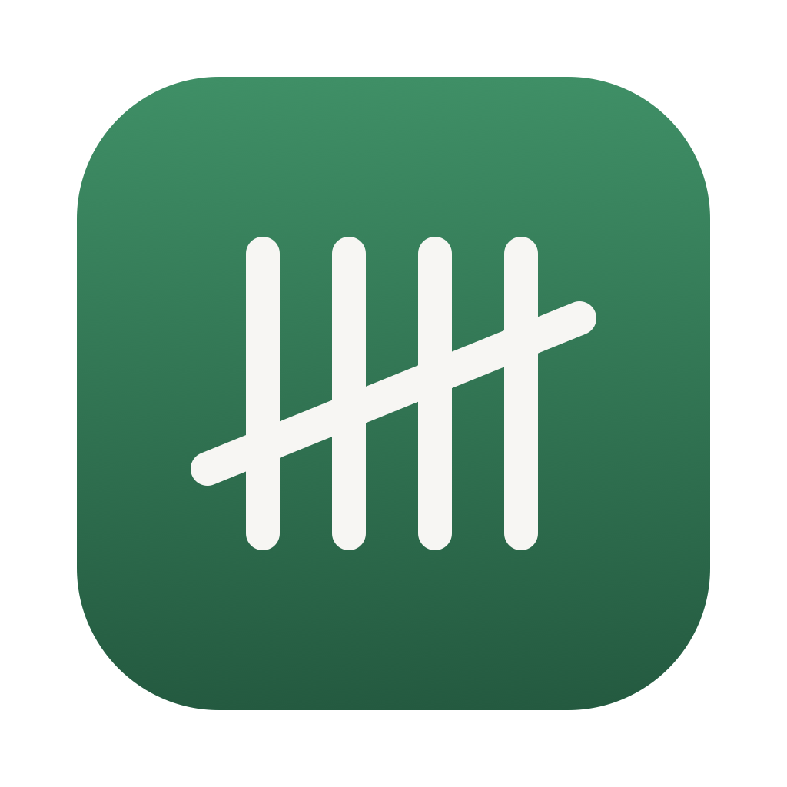

<p align="center">
  
</p>

<h1 align="center">Tally</h1>

<p align="center">A personal habit and challenge tracker for macOS. Built in public.</p>

<p align="center">
  <a href="https://github.com/deynerhiguera/tally/actions/workflows/ci.yml"></a>
</p>

---

> **Status:** early development. Follow progress in the [MVP milestone](https://github.com/deynerhiguera/tally/milestone/1).

## What it does

Tally tracks two kinds of habits:

- **Build** habits you want to do: review Anki cards, 10 minutes of mobility.
- **Break** habits you want to keep inside a limit: at most one episode of a series per day, bread at most once a week.

Each habit uses one of five targets:

| Target          | Example                                                |
| --------------- | ------------------------------------------------------ |
| Daily check     | Did I review Anki today?                               |
| Daily limit     | ≤ 1 episode per day                                    |
| Weekly limit    | Bread ≤ 1 time per week                                |
| Target time     | Wake up by 05:00. Shows how many minutes early or late |
| Daily scale 1–5 | Stress level, with an optional note                    |

Planned screens:

- **Today:** log everything in a few clicks.
- **Month grid:** habits × days 1–31, with weekends shaded, like a paper poster tracker.
- **Habit detail:** current and best streak, success rate, and a trend chart for scale habits.
- **Manage habits:** create, edit and archive.
- **Demo mode:** swaps in fake data for screenshots and videos.
- **JSON backup:** export and import all data.

All data stays on your Mac. There is no account, no cloud and no tracking.

## Why I built it

I used to track habits on a paper poster: one row per habit, one column per day. I liked seeing the whole month at once. I wanted that view, plus things paper can't do. Tally handles limits ("at most once a week"), times ("in bed by 22:00"), how I felt on a 1–5 scale, and streaks calculated for me. I'm building it in public to learn and to keep myself accountable.

## Screenshots

_Coming soon, taken in demo mode only._

## Install on a Mac (Apple Silicon)

Requirements: an Apple Silicon Mac (M1 or later), [Node.js](https://nodejs.org) 26 or later, and Git.

```bash
git clone https://github.com/deynerhiguera/tally.git
cd tally
npm install
npm run install:mac
```

This builds `Tally.app` and copies it into `/Applications`, replacing any older version. Then open it like any other app: press **Cmd + Space** and type "Tally", use Launchpad, or right-click its Dock icon and choose **Options → Keep in Dock**.

To update, run `git pull && npm install && npm run install:mac`. Your data is stored in `~/Library/Application Support/Tally`, outside the app, so it survives updates and reinstalls.

### Demo mode

**Settings → Demo mode** swaps in example habits with 90 days of fake history, so you can record videos or take screenshots without showing your own data. Your real data is not shown or changed while it is on, and the demo data is reset each time you turn it on. A **Demo data** badge in the sidebar shows when it is active. Backups are disabled in demo mode.

### Backups

Open **Settings → Backup** to export all your data to a JSON file, for example in iCloud Drive. To restore, choose **Import backup…**. Tally shows what the file contains before anything changes. If you confirm, it saves a copy of your current data to `~/Library/Application Support/Tally/backups/` and then replaces it.

### If macOS blocks the app the first time

Tally is not signed with an Apple Developer ID. The install script signs it locally (ad-hoc) and removes the quarantine flag, so it normally opens right away. If macOS still says the app "can't be opened" or is "from an unidentified developer":

1. Open **System Settings → Privacy & Security**.
2. Scroll down to the message about Tally and click **Open Anyway**, then confirm.

Or, from Terminal:

```bash
xattr -dr com.apple.quarantine /Applications/Tally.app
```

You only need to do this once per install.

## Development

```bash
npm run dev         # run with hot reload
npm test            # unit and component tests (Vitest + Testing Library)
npm run typecheck   # TypeScript strict
npm run lint        # ESLint + Prettier check: npm run format:check
```

## Tech stack

- [Electron](https://www.electronjs.org) and [electron-vite](https://electron-vite.org), packaged with [electron-builder](https://www.electron.build) for Apple Silicon
- [React](https://react.dev), [React Router](https://reactrouter.com) and TypeScript (strict)
- SQLite through Node's built-in [`node:sqlite`](https://nodejs.org/api/sqlite.html) in the main process for local storage (no native modules)
- [Vitest](https://vitest.dev) and [Testing Library](https://testing-library.com), ESLint, Prettier, GitHub Actions

The business logic (streaks, limits, scoring) is pure TypeScript in `src/shared/domain`. The React UI talks to Electron only through a typed preload API, so both can be reused for a future web or mobile version.

## License

[MIT](LICENSE) © Deyner Higuera
