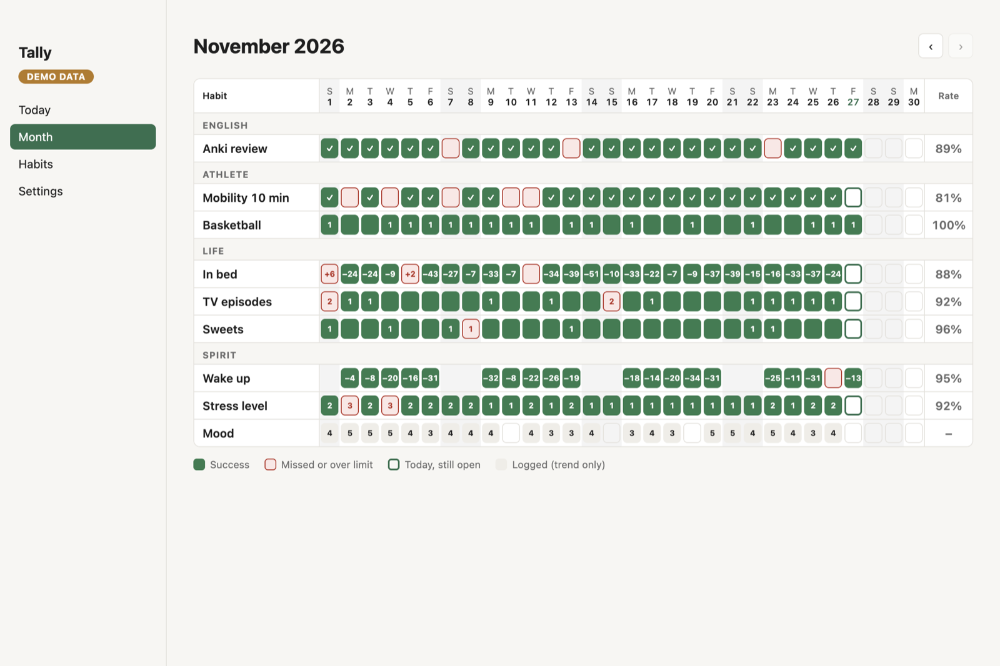
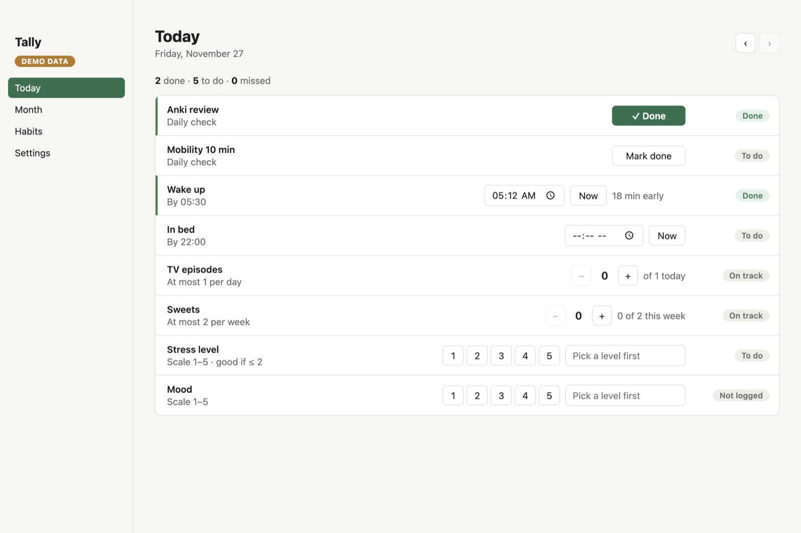
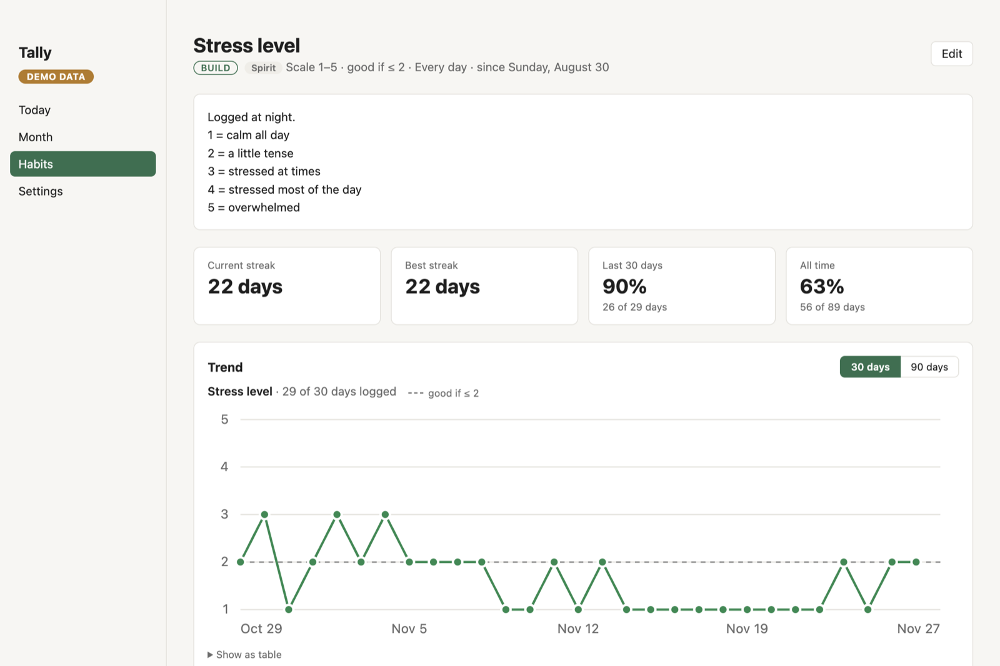
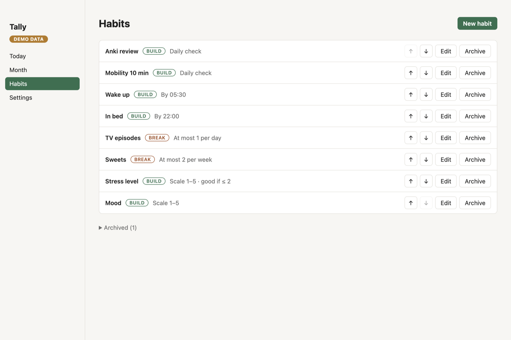
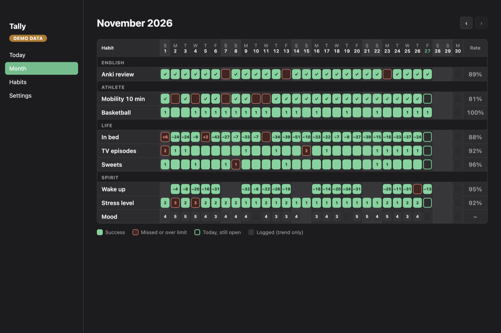

<p align="center">
  
</p>

<h1 align="center">Tally</h1>

<p align="center">A personal habit and challenge tracker for macOS. Built in public.</p>

<p align="center">
  <a href="https://github.com/deynerhiguera/tally/actions/workflows/ci.yml"></a>
  
  <a href="LICENSE"></a>
</p>

<p align="center">
  
</p>

> All screenshots use Tally's built-in **demo mode**. They show example data, not real habits.

## What it does

Tally tracks two kinds of habits:

- **Build** habits, which you want to do: review Anki cards, 10 minutes of mobility.
- **Break** habits, which you want to keep inside a limit: at most one TV episode a day, sweets at most twice a week.

Each habit uses one of five targets:

| Target              | Example                   | Counts as a success when…                                       |
| ------------------- | ------------------------- | --------------------------------------------------------------- |
| **Daily check**     | Anki review               | it's done that day                                              |
| **Daily limit**     | ≤ 1 TV episode a day      | the day's count stays within the limit                          |
| **Weekly limit**    | Sweets ≤ 2 times a week   | the week's total stays within the limit                         |
| **Target time**     | Wake up by 05:30          | it's at or before the goal; shows minutes early or late         |
| **Daily scale 1–5** | Stress level, with a note | it meets an optional "good if ≤ 2" rule, or just tracks a trend |

### Screens

|                                                                                                                               |                                                                                                                                 |
| ----------------------------------------------------------------------------------------------------------------------------- | ------------------------------------------------------------------------------------------------------------------------------- |
|                                                                                    |                                         |
| **Today:** log every habit in a few clicks: a check, a +/− counter, a time (with "18 min early"), or a 1–5 level with a note. | **Habit detail:** current and best streak, success rate, average distance from a time goal, and a trend chart for scale habits. |
|                                                                                    |                                                                      |
| **Habits:** create, edit, reorder and archive. Archived habits keep their history.                                            | **Month grid** in dark mode: weekends shaded, success rate per habit, and you can click any day to edit it.                     |

It also has:

- **A menu bar icon** with today's progress (like `3/7`). Click it to see each habit's status and open Tally. You can turn it off in Settings.
- **Light and dark mode** that follow macOS.
- **Demo mode** for recording videos without showing your data.
- **JSON backups** that you can export and import.

All data stays on your Mac. There is no account, no cloud and no tracking.

## Why I built it

I used to track habits on a paper poster: one row per habit, one column per day. I liked seeing the whole month at once. I wanted that view, plus things paper can't do:

- limits ("at most once a week")
- times ("in bed by 22:00, and how late was I?")
- how I felt on a 1–5 scale
- streaks calculated for me

I'm building it in public to learn, and to keep myself accountable. Follow along in the [issues and pull requests](https://github.com/deynerhiguera/tally/pulls?q=is%3Apr).

## Install on a Mac (Apple Silicon)

Requirements: an Apple Silicon Mac (M1 or later) with macOS 13 or later, [Node.js](https://nodejs.org) 26 or later, and Git.

```bash
git clone https://github.com/deynerhiguera/tally.git
cd tally
npm install
npm run install:mac
```

`npm run install:mac` does four things:

1. builds `Tally.app`
2. signs it locally (ad-hoc)
3. removes the macOS quarantine flag
4. copies it into `/Applications`, replacing any older version

Then open it like any other app: press **Cmd + Space** and type "Tally", use Launchpad, or right-click its Dock icon and choose **Options → Keep in Dock**. Opening it again while it's running brings the existing window to the front.

To update, run `git pull && npm install && npm run install:mac`.

### If macOS blocks the app the first time

Tally isn't signed with an Apple Developer ID. macOS only checks apps that carry the quarantine flag, which is added to files downloaded from the internet. The install script builds the app on your Mac and removes that flag, so it normally opens straight away.

If you copied a built `Tally.app` from somewhere else, or macOS still says it "can't be opened" or is "from an unidentified developer":

1. Try to open Tally once and close the warning.
2. Open **System Settings → Privacy & Security**.
3. Scroll down to the message about Tally, click **Open Anyway**, and confirm with your password or Touch ID.

Or, from Terminal:

```bash
xattr -dr com.apple.quarantine /Applications/Tally.app
```

You only need to do this once per install.

## Your data

- **Where it lives:** `~/Library/Application Support/Tally/tally.db`, a single SQLite file outside the app. It survives updates and reinstalls.
- **Backups:** open **Settings → Backup** to export everything to a JSON file, for example in iCloud Drive. To restore, choose **Import backup…**. Tally shows what the file contains before anything changes. If you confirm, it saves a copy of your current data to `~/Library/Application Support/Tally/backups/` first.
- **Demo mode:** **Settings → Demo mode** swaps in example habits with 90 days of history, so you can record or take screenshots without showing your own data.
  - Your real data isn't shown or changed while it's on.
  - The demo data resets each time you turn it on.
  - A **Demo data** badge shows in the sidebar.
  - Backups are disabled in demo mode.

## Development

```bash
npm run dev             # run with hot reload (uses a separate "Tally Dev" data folder)
npm test                # unit and component tests (Vitest + Testing Library)
npm run test:coverage   # tests with coverage; the domain layer must stay at 100%
npm run typecheck       # TypeScript strict
npm run lint            # ESLint (npm run format:check for Prettier)
npm run install:mac     # build and install the app into /Applications
```

CI runs lint, format check, typecheck and tests on every pull request.

### How it's organized

```
src/
  shared/domain/   Pure TypeScript: habit model, day scoring, streaks, stats (no Electron, Node or React)
  shared/api/      The TallyApi contract, input validation, backup format
  shared/demo/     Demo data generator
  main/            Electron main process: window, SQLite storage, IPC, backups, demo mode
  preload/         Exposes TallyApi to the UI as window.tally
  renderer/        React UI (talks to the platform only through TallyApi)
```

The business logic is pure TypeScript. The React UI depends only on a typed API contract, never on Electron directly. Both can be reused later for a web or mobile version with a different storage backend.

## Tech stack

- [Electron](https://www.electronjs.org) and [electron-vite](https://electron-vite.org), packaged with [electron-builder](https://www.electron.build) for Apple Silicon
- [React](https://react.dev), [React Router](https://reactrouter.com) and TypeScript (strict)
- SQLite through Node's built-in [`node:sqlite`](https://nodejs.org/api/sqlite.html) in the main process (no native modules)
- Charts are hand-written SVG, with no chart library
- [Vitest](https://vitest.dev), [Testing Library](https://testing-library.com), ESLint, Prettier and GitHub Actions

## Roadmap

- [x] MVP: Today, Month grid, Habit detail, Manage habits, backups, demo mode ([milestone](https://github.com/deynerhiguera/tally/milestone/1))
- [x] Menu bar icon with today's progress
- [ ] Daily reminder notification, final app icon ([Post-MVP](https://github.com/deynerhiguera/tally/milestone/2))

## License

[MIT](LICENSE) © Deyner Higuera
